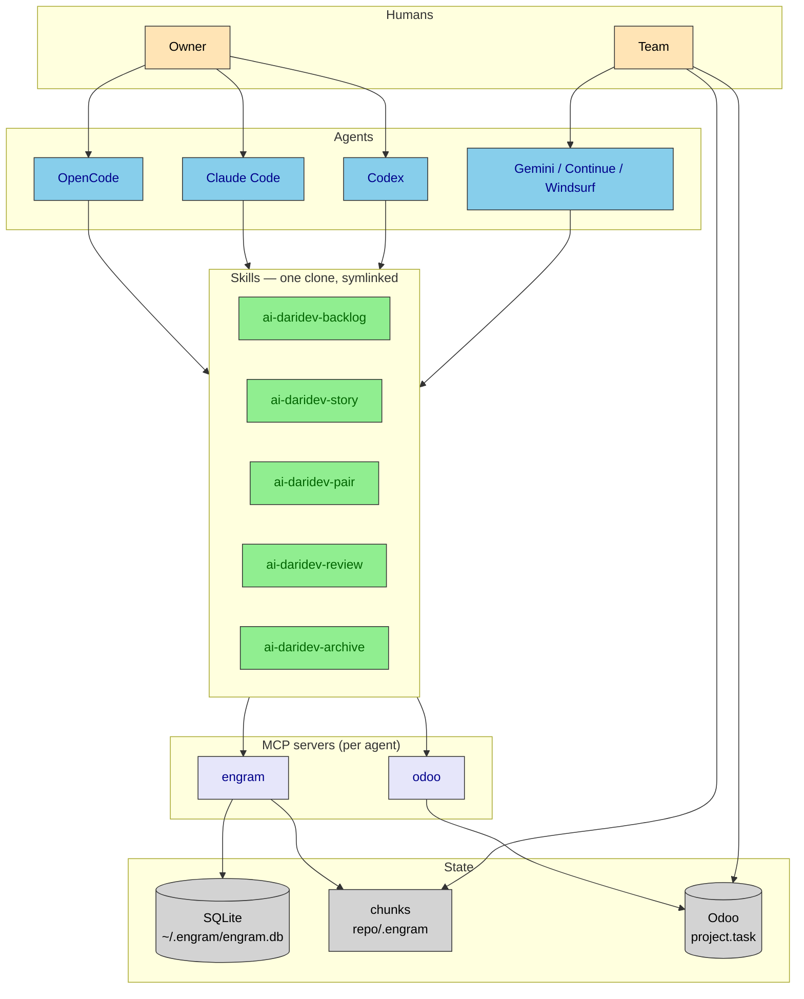
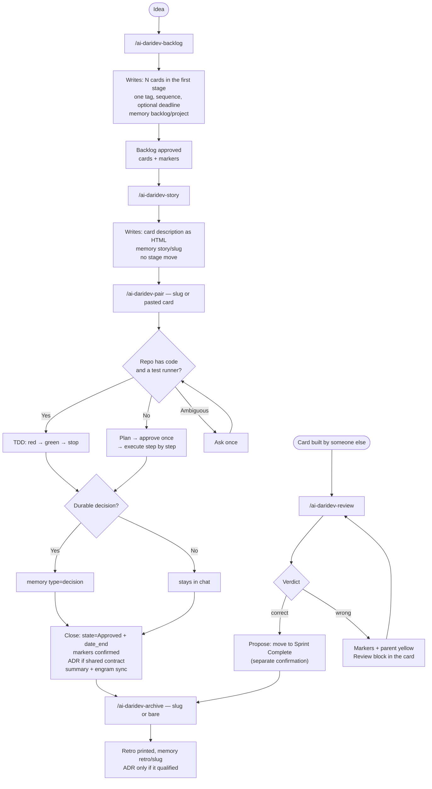
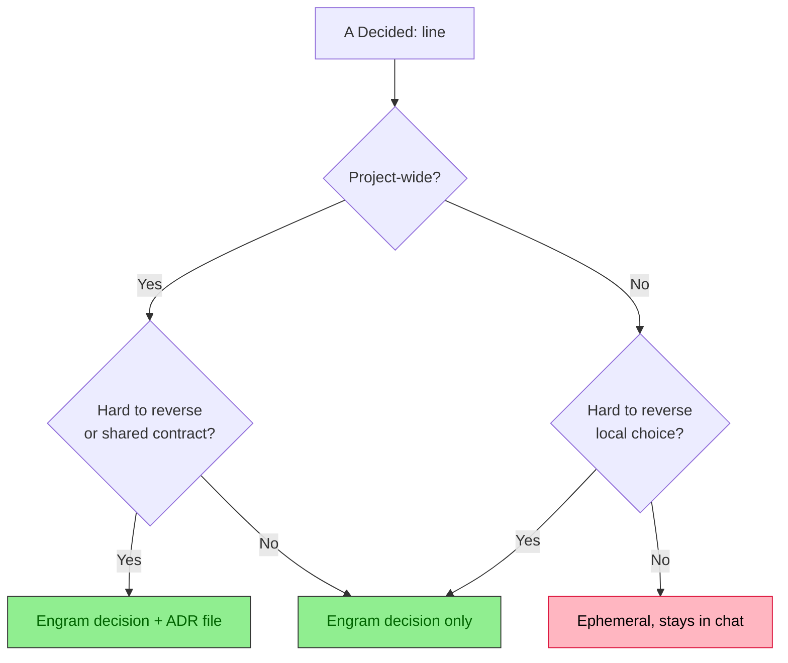
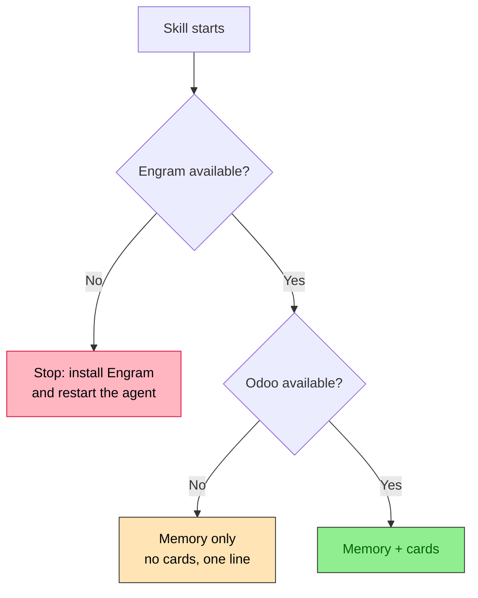

# Architecture

The integration has three layers. You type commands; the skills decide; the MCP servers are the
only thing that touches real data.

## Division of responsibility

| Question | Answered by | Because |
|---|---|---|
| What is the work? | Odoo card | humans need to see it |
| Where is it in the process? | Odoo stage — **moved only by a human** | automation must not lie about status |
| Why was it built this way? | Engram decisions | searchable, per project, survives sessions |
| What does a reviewer read? | `docs/decisions/<slug>.md` | a diff, in the PR |
| What did the last story change? | Engram session summary | the agent's own trail |

Odoo is deliberate, visible and slow. Engram is automatic, invisible and fast. There is no two-way
sync: Odoo is authoritative for **state**, Engram for **knowledge**.

## Lifecycle

## What gets remembered

A `Decided:` line is only saved when it will still matter next month.

## When a tool is missing

**Engram is required**: without memory the skill stops and asks you to install it. **Odoo is
optional**: without it the skill says one line and continues without cards.

Next: [workflow](workflow.md) · [odoo](odoo.md) · [engram](engram.md)
