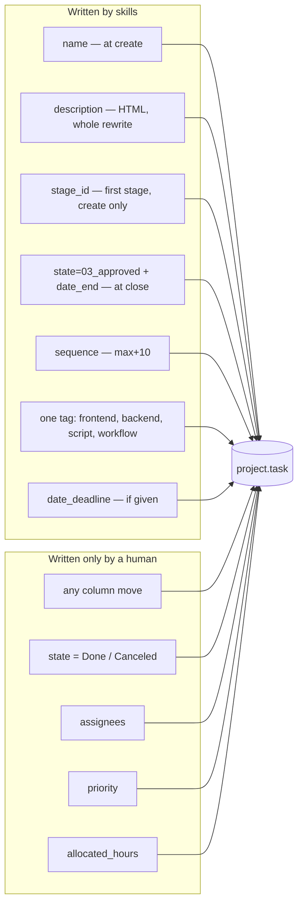
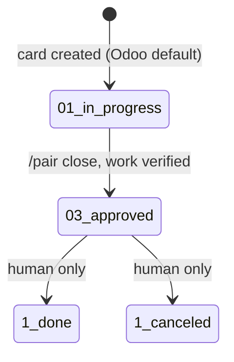

# Odoo — the card contract

The skills treat Odoo as a **work-item board owned by humans**. They create cards and update two
fields at close. They never decide where a card lives.

## Who writes what



## State machine



`Done` and `Canceled` are never written by a skill, even when the work is finished. "Finished" is
`Approved`; shipping is a human decision.

## Fields written at creation

| Field | Value | Why |
|---|---|---|
| `name` | the story title | the card is self-explanatory on the board |
| `project_id` | resolved by **name** from `AGENTS.md` | IDs differ per instance |
| `stage_id` | the project's **first** stage by `sequence` | new work always starts at the beginning |
| `sequence` | `max(sequence in project) + 10` | keeps the backlog order inside the column |
| `description` | HTML body (below) | readable in Odoo, greppable by the key |
| `tag_ids` | exactly one of `frontend` / `backend` / `script` / `workflow` | one axis, no taxonomy drift |
| `date_deadline` | only if the user gave one, UTC `YYYY-MM-DD 00:00:00` | a fake deadline is worse than none |

Never set: `state` (defaults), `allocated_hours`, `priority`, `user_ids`, `partner_id`.

## Card body

Regenerate the whole `description` on every update — never append. Escape `<`, `>`, `&`.

```html
<h1>{the card's CURRENT name}</h1>
<p>{one-line goal}</p>
<h2>Acceptance criteria</h2>
<ul><li>Given …, when …, then …</li></ul>
<h2>Tests</h2>
<ol><li>{test name} — {where it runs}</li></ol>
<p><em>engram: story/{slug}</em></p>
```

- `<h1>` is read from the live task name first, so renaming a card is not reverted on the next update.
- No `<pre>` for prose; monospace only for code.
- The `engram:` line is the idempotency key.

## Idempotency

Before creating anything, search the project for a description containing `engram: story/<slug>`.

- found → update instead of create (and ask before creating when a story is new);
- not found → create, in one contiguous batch, reporting `id · name · stage · tag`;
- approval denied mid-batch → stop and list what exists, so a re-run resumes without duplicates.

## Why stages are never automated

A column means "a human says this is here". If an agent moved cards, the board would be a guess
about work it cannot see. `state=Approved` + `date_end` are the agent's only claims, and both are
visible and reversible by you.

## Setup checklist

- [ ] the project exists and has the stages you use (they are per project in Odoo)
- [ ] the tags the workflow needs exist (global: `frontend`, `backend`, `script`, `workflow`)
- [ ] `AGENTS.md` declares `odoo_project` and `odoo_stages`
- [ ] the MCP server runs through a wrapper that reads credentials from a 600 file
- [ ] write tools are set to `ask` in the agent permissions
