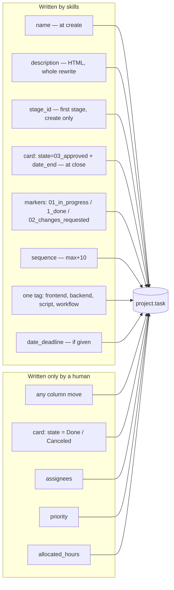
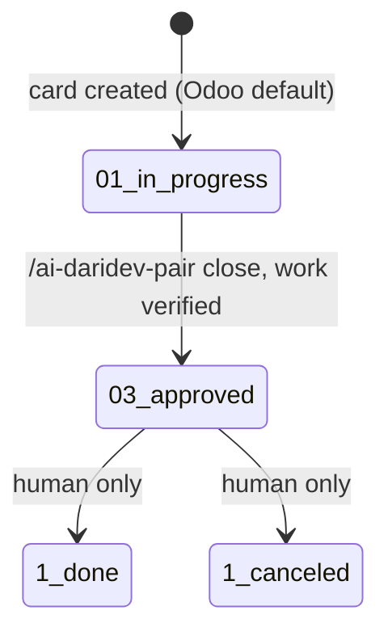
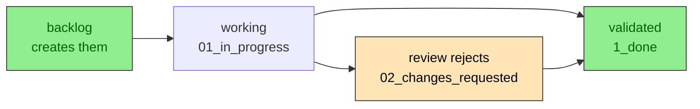

# Odoo — the card contract

The skills treat Odoo as a **work-item board owned by humans**. They create cards and update two
fields at close. They never decide where a card lives.

## Who writes what



## Identity

The MCP authenticates with its own credentials, often a service account — not you. The skills
never assume otherwise:

- `odoo_uid` is **personal**: it lives in `~/.config/ai-daridev/repos/<repo>.json`, never in the
  committed block. Set it with `ai-daridev uid <n>`.
- It marks which cards are yours in listings; it never filters them out.
- New cards are created **unassigned**. `user_ids` is written only when you explicitly ask for an
  assignee in the same run.
- `res.users` is never read — the uid comes from the personal file.

## Preflight

`ai-daridev preflight` resolves the project, the stage roles and the tags, and stops on any
inconsistency before a skill writes. The contract, the JSON and the error list live in
[preflight.md](preflight.md).

## State machine



On a **card**, `Done` and `Canceled` are never written by a skill, even when the work is finished:
the card would disappear from the default kanban. "Finished" for a card is `Approved`; shipping is a
human decision. Subtasks are the exception — markers use `1_done` (see below).

## Fields written at creation

| Field | Value | Why |
|---|---|---|
| `name` | the story title | the card is self-explanatory on the board |
| `project_id` | resolved by **name** from `AGENTS.md` | IDs differ per instance |
| `stage_id` | the project's **first** stage by `sequence` | new work always starts at the beginning |
| `sequence` | `max(sequence in project) + 10` | keeps the backlog order inside the column |
| `description` | HTML body (below) | readable in Odoo, greppable by the key |
| `tag_ids` | one of `frontend` / `backend` / `script` / `workflow`, default `card_tag` | one axis, no taxonomy drift |
| `date_deadline` | only if the user gave one, UTC `YYYY-MM-DD 00:00:00` | a fake deadline is worse than none |
| markers (subtasks) | created after the card: `name`, `parent_id`, `project_id`, `state=01_in_progress` | tracking only — no description, no column, no dates |

Never set: `state` (defaults), `allocated_hours`, `priority`, `user_ids`, `partner_id`.

## Card body

Regenerate the whole `description` on every update — never append. Escape `<`, `>`, `&`.

```html
<h1>{the card's CURRENT name}</h1>
<p>{one-line goal}</p>
<h2>Acceptance criteria</h2>
<ul><li>Given …, when …, then …</li></ul>
<h2>Tests</h2>
<ol><li>{test name} — {where it runs}</li></ol>
<h2>Review (ai-daridev)</h2>
<p><b>{date}</b> — changes requested</p>
<ul><li><b>{marker}</b>: {what is wrong}</li></ul>
<p>Markers: {marker 1} · {marker 2}</p>
<p><em>engram: story/{slug}</em></p>
```

- `<h1>` is read from the live task name first, so renaming a card is not reverted on the next update.
- No `<pre>` for prose; monospace only for code.
- The `Markers:` line mirrors the subtasks, so a teammate without Odoo can recreate them. It is
  rewritten whenever a marker is added or removed.
- The `Review (ai-daridev)` block belongs to `/ai-daridev-review`. It runs from its heading to the
  `engram:` line; other skills preserve it verbatim and re-insert it in the same place.
- The `engram:` line is the idempotency key and stays last.

## Markers (subtasks)



- Hidden inside the parent card, so their column is cosmetic: never write `stage_id`.
- No description, no dates, no key. Detail belongs in the card's Review block.
- **Markers are the only things that use `1_done`.** The card never uses Done/Canceled: it would
  disappear from the default kanban. The card closes at `03_approved`.
- Because `closed_subtask_count` counts Done + Canceled, a card with two validated markers shows
  `2/3` — that is exactly why markers use `1_done` and not `03_approved`.

## Without Odoo

Every skill that would write prints a copy-paste checklist instead:

- the card name and the state to set,
- the markers to create or flip, and to which state,
- the description or Review block to paste,
- the column move as a manual action: "in Odoo, or ask the owner".

## Idempotency

Before creating anything, search the project for a description containing `engram: story/<slug>`.

- found → update instead of create (and ask before creating when a story is new);
- not found → create, in one contiguous batch, reporting `id · name · stage · tag`;
- approval denied mid-batch → stop and list what exists, so a re-run resumes without duplicates.

## Why stages are never automated

A column means "a human says this is here". If an agent moved cards, the board would be a guess
about work it cannot see. `state=Approved` + `date_end` are the agent's only claims, and both are
visible and reversible by you.

## Setup checklist

- [ ] the project exists and has the stages you use (they are per project in Odoo)
- [ ] the block uses stage **roles** (`odoo_stage_backlog/active/done/cancelled`) and every name exists
- [ ] the tags the workflow needs exist (global: `frontend`, `backend`, `script`, `workflow`)
- [ ] `ai-daridev init` generated the block and `ai-daridev preflight` passes
- [ ] the MCP server runs through a wrapper that reads credentials from a 600 file
- [ ] write tools are set to `ask` in the agent permissions
