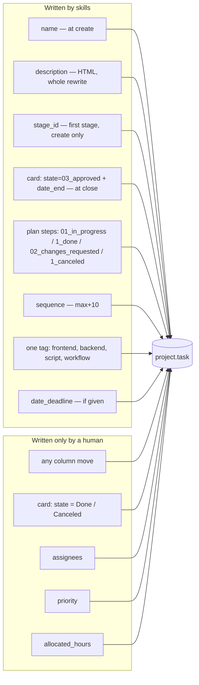
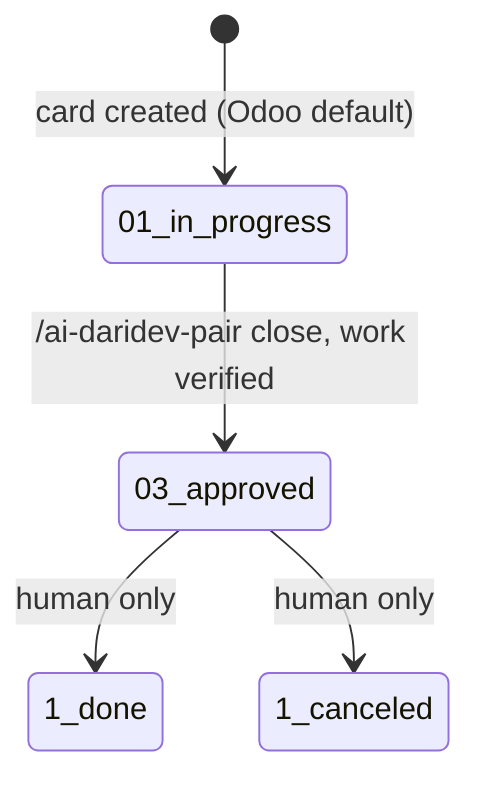
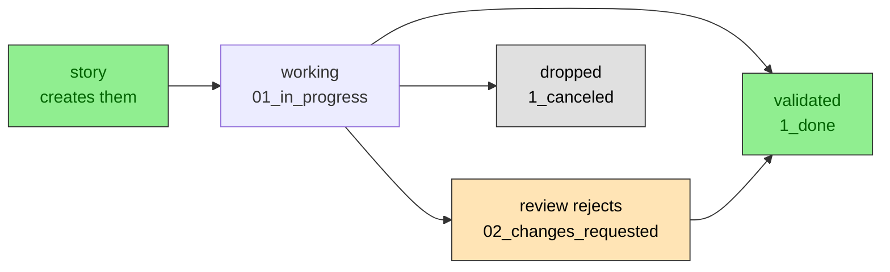

# Odoo — the card contract

The skills treat Odoo as a **work-item board owned by humans**. They create cards and update two
fields at close. They never decide where a card lives.

## Who writes what



## Identity

The MCP authenticates with its own credentials, often a service account — not you. The skills
never assume otherwise:

- `odoo_uid` is **personal**: it lives in `~/.config/ai-daridev/repos/<repo>.json`, never in the
  committed block. Set it with `ai-daridev uid <n>`.
- It marks which cards are yours in listings; it never filters them out.
- New cards are created **unassigned**. `user_ids` is written only when you explicitly ask for an
  assignee in the same run.
- `res.users` is never read — the uid comes from the personal file.

## Preflight

`ai-daridev preflight` resolves the project, the stage roles and the tags, and stops on any
inconsistency before a skill writes. The contract, the JSON and the error list live in
[preflight.md](preflight.md).

## State machine



On a **card**, `Done` and `Canceled` are never written by a skill, even when the work is finished:
the card would disappear from the default kanban. "Finished" for a card is `Approved`; shipping is a
human decision. Plan steps (subtasks) are the exception — they use `1_done` and `1_canceled` (see
below).

## Fields written at creation

| Field | Value | Why |
|---|---|---|
| `name` | the story title | the card is self-explanatory on the board |
| `project_id` | resolved by **name** from `AGENTS.md` | IDs differ per instance |
| `stage_id` | the project's **first** stage by `sequence` | new work always starts at the beginning |
| `sequence` | `max(sequence in project) + 10` | keeps the backlog order inside the column |
| `description` | HTML body (below) | readable in Odoo, greppable by the key |
| `tag_ids` | one of `frontend` / `backend` / `script` / `workflow`, default `card_tag` | one axis, no taxonomy drift |
| `date_deadline` | only if the user gave one, UTC `YYYY-MM-DD 00:00:00` | a fake deadline is worse than none |
| plan steps (subtasks) | created after the card from the plan: `name`, `description` = `ai-daridev: plan/<slug>#pN` + detail, `sequence` = index × 10, `parent_id`, `state=01_in_progress`, `user_ids=[]`, **`display_in_project=False`** — never `project_id` (computed), never `stage_id` | the plan is the checklist; detail lives here and on the card |

Never set: `state` (defaults), `allocated_hours`, `priority`, `user_ids`, `partner_id`.

## Card body

Regenerate the whole `description` on every update — never append. Escape `<`, `>`, `&`.

```html
<h1>{the card's CURRENT name}</h1>
<p>{one-line goal}</p>
<h2>Acceptance criteria</h2>
<ul><li>Given …, when …, then …</li></ul>
<h2>Plan</h2>
<ol><li><b>p1</b> {step name}<ul><li>{detail: files, command, rollback}</li></ul></li></ol>
<h2>Tests</h2>
<ol><li>{test name} — {where it runs} — covers p1</li></ol>
<h2>Review (ai-daridev)</h2>
<p><b>{date}</b> — changes requested</p>
<ul><li><b>p3 · {step}</b>: {what is wrong}</li></ul>
<p>Plan: p1=14843 · p2=14844</p>
<p><em>engram: story/{slug}</em></p>
```

- `<h1>` is read from the live task name first, so renaming a card is not reverted on the next update.
- No `<pre>` for prose; monospace only for code.
- `<h2>Plan</h2>` is the human-readable list: step name plus its detail sub-bullet, **no status**
  (status lives in the subtasks). It is regenerated from `plan/<slug>` on every plan change.
- The `Plan:` line is machine-owned and derived from the children: keys and their Odoo ids only.
  A human edit is ignored and rebuilt on the next sync; it is never the authority.
- The `Review (ai-daridev)` block belongs to `/ai-daridev-review`. It runs from its heading to the
  `engram:` line; other skills preserve it verbatim and re-insert it in the same place.
- The `engram:` line is the idempotency key and stays last.

## Plan steps (subtasks)



One checklist per card: the plan steps **are** the subtasks. There is no separate "markers" concept.

- **Key.** `description` starts with `ai-daridev: plan/<slug>#pN`, followed by the detail HTML.
  The key is the identity: names may change, keys never do and are never reused.
- **Name.** The step as it appears in the card's `<h2>Plan</h2>`: verb-first, ≤80 chars.
- **Hidden by `display_in_project=False`.** The project task action filters on
  `display_in_project = True`, which is the supported switch (the form's "Hide the sub-task in your
  pipeline" option). A subtask **cannot** be project-less: there is a SQL constraint, and
  `project_id` is computed from the parent — so the skills never write it (nor `stage_id`).
- **Sequence** = step index × 10, so the form order matches the plan. Rewritten only when the
  order changes.
- **One call per subtask.** The MCP has no bulk create, so a 10-step plan is 10 `odoo_create`
  calls; with `ask` permissions that is one approval per step, by design.
- **States.** `01_in_progress` open · `1_done` validated · `02_changes_requested` rejected by a
  review · `1_canceled` dropped. Only open/blocked steps can be dropped; a validated step is never
  canceled. The **card** never uses `1_done` or `1_canceled`: it closes at `03_approved`.
- Because `closed_subtask_count` counts Done + Canceled, dropped steps inflate Odoo's progress
  badge; the chat render always prints the real breakdown (`done · dropped · open · blocked`).

### Sync (split authority)

Odoo records **what exists**; `plan/<slug>` records **intent**. Neither silently overwrites the
other.

1. Read the card (by `engram: story/<slug>`), its children (`name`, `description`, `state`,
   `sequence`) and `write_date`.
2. Index children by key in `description`; fall back to normalized name only for legacy children.
3. Diff against `plan/<slug>`: added, renamed, reordered, removed, state changed.
4. **Structure** (added/renamed/reordered/removed) → one approval gate with a `Was | Now` table and
   the exact writes. **State** changes → no gate, reported inline.
5. If `write_date` changed since step 1, re-read and re-diff before writing.
6. Apply: create → update states → sequences → description → read back `display_in_project`.
7. Resolution is written to the losing side, so the same conflict is never asked twice.
8. A keyed child that disappeared was deleted by a human: ask **restore** or **drop**, never
   silently recreate.
9. Unkeyed children are never touched. List them once and ask: adopt as steps or ignore. The
   answer is remembered in `plan/<slug>`.
10. Idempotency: a second sync with no changes must produce zero writes.

### Legacy cards

Cards with a `Markers:` line and no `Plan:` line are legacy. The first sync asks once: convert the
markers into steps (same ids, gain keys and sequence) or start a fresh plan. Conversion is the
default; the answer is remembered. Converted steps start with an empty detail.

### Rendering

Every skill that changes the plan prints it in chat, with or without Odoo:

```
Plan · charge-before-scan · 4/9 done · 1 dropped · synced
- [x] p1 Re-export live automations — agent — done
- [x] p2 Charge in one statement — agent — done
- [ ] p3 409 response — agent — changes requested
- [ ] p4 Drop project join — agent — dropped
- [ ] p5 Staging test with a 1-use code — you — open

next: p5 (you)
```

Full list on any plan change, **including a state flip**; only a stop with nothing changed prints
the single `plan 4/9 · next p5` line. When Odoo is unavailable the footer says `not synced` and the state comes from
`plan/<slug>`. The card description stays status-free.

## Without Odoo

Every skill that would write prints a copy-paste checklist instead:

- the card name and the state to set,
- the steps to create, rename, drop or flip, and to which state,
- the description or Review block to paste,
- the column move as a manual action: "in Odoo, or ask the owner".

## Idempotency

Before creating anything, search the project for a description containing `engram: story/<slug>`.

- found → update instead of create (and ask before creating when a story is new);
- not found → create, in one contiguous batch, reporting `id · name · stage · tag`;
- approval denied mid-batch → stop and list what exists, so a re-run resumes without duplicates;
- the plan's step keys (the `pN` in `description`) are the idempotency key for subtasks.

## Why stages are never automated

A column means "a human says this is here". If an agent moved cards, the board would be a guess
about work it cannot see. `state=Approved` + `date_end` are the agent's only claims, and both are
visible and reversible by you.

## Setup checklist

- [ ] the project exists and has the stages you use (they are per project in Odoo)
- [ ] the block uses stage **roles** (`odoo_stage_backlog/active/done/cancelled`) and every name exists
- [ ] the tags the workflow needs exist (global: `frontend`, `backend`, `script`, `workflow`)
- [ ] `ai-daridev init` generated the block and `ai-daridev preflight` passes
- [ ] the MCP server runs through a wrapper that reads credentials from a 600 file
- [ ] write tools are set to `ask` in the agent permissions
