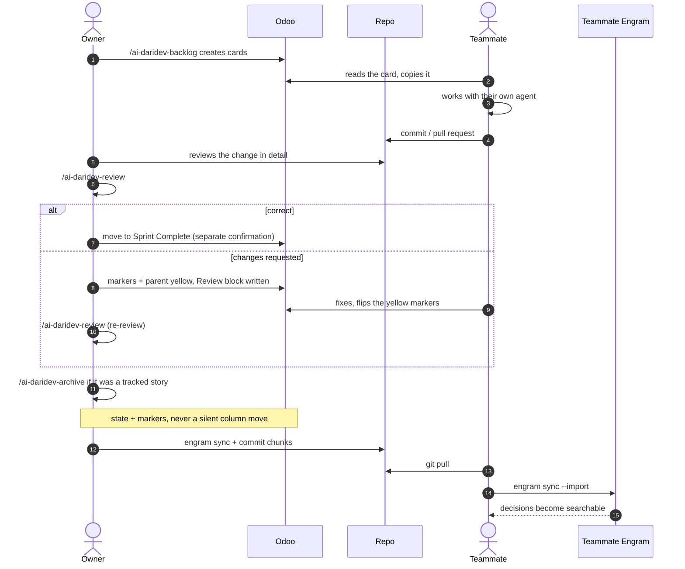

# Team

One person owns the board and the memory; everybody can work on the cards.

## Roles

| Role | Needs | Does |
|---|---|---|
| Owner | Engram, skills, Odoo | `/ai-daridev-backlog`, `/ai-daridev-story`, `/ai-daridev-pair`, `/ai-daridev-review`, `/ai-daridev-archive`; moves columns, validates work |
| Teammate | Engram, skills (Odoo optional) | picks a card, pastes it into their agent, builds, flips markers, submits the change |

The owner is the only one who moves cards and the only one who marks work done. That is what keeps
the board honest.

## How the team builds

**Everyone builds with the agent.** It is what makes the card, the markers and the memory agree
with the code. Manual work is not forbidden, but then the person who did it updates the card and
the markers by hand — the board may not silently disagree with reality.

If the agent has no Odoo connection, it prints the checklist instead of writing: card state,
markers and states, the text to paste, and "the column is the owner's". Nothing is left implicit.

## Markers

Teammates create the markers they need (name only, no description) and flip them:

- gray while working (`01_in_progress`),
- done when they consider it validated (`1_done`) — this is what moves the card's `2/3` badge,
- yellow only when a review asks for changes (`02_changes_requested`).

Markers are hidden inside the card, so they never clutter a column. The card itself never uses Done
or Canceled — it would disappear from the default kanban.

## The loop



## What a teammate needs

```bash
git clone <this-repo>
cd ai-daridev
./scripts/install.sh        # Linux / macOS
# .\scripts\install.ps1     # Windows
```

That is enough for `/ai-daridev-backlog`, `/ai-daridev-story`, `/ai-daridev-pair`, `/ai-daridev-archive` to run: the installer brings Engram
with it. Odoo is optional, so a teammate without it still remembers decisions and just creates no
cards.

## Card hand-off

Cards are written to be self-sufficient, because a teammate may never see Engram:

```html
<h1>Retry-safe upload</h1>
<p>Uploads must survive retries without duplicating records.</p>
<h2>Acceptance criteria</h2>
<ul><li>Retrying never creates a second record</li></ul>
<h2>Tests</h2>
<ol><li>retry twice → exactly one record</li></ol>
<p><em>engram: story/retry-safe-upload</em></p>
```

The title, the criteria and the tests are the whole contract. The `engram:` line is for the agent,
not for the reader.

## Shared memory

```bash
# after pulling
engram sync --import

# before pushing
engram sync && git add .engram/ && git commit -m "chore: memory — <story>"
```

- Every sync writes a **new** chunk; nobody edits a chunk somebody else created.
- The manifest is the only shared file and merges by keeping both entries.
- `scope: personal` is **not** private: everything in an enrolled project is exported.
- Never put secrets, credentials or client data in memory.
