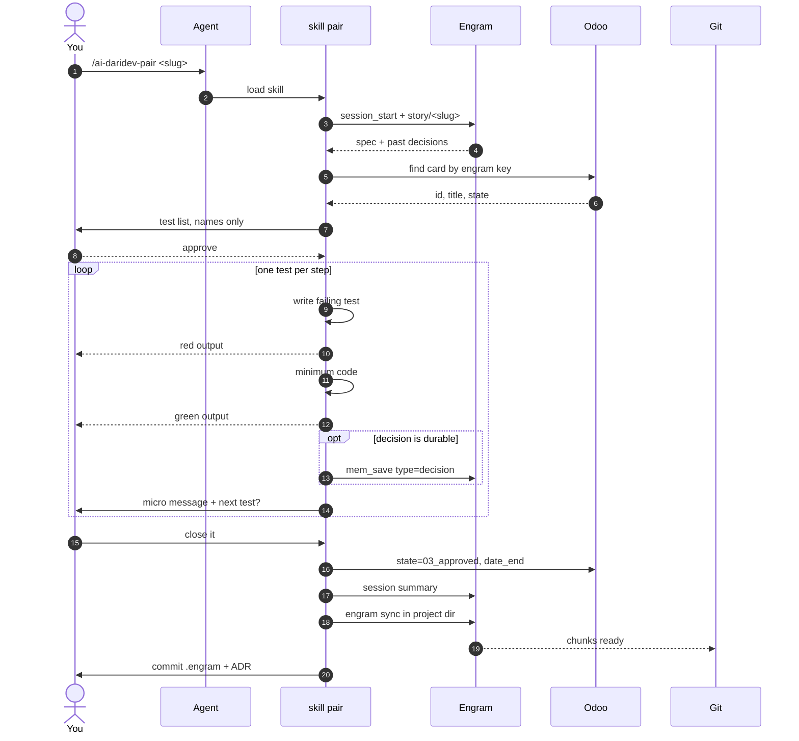
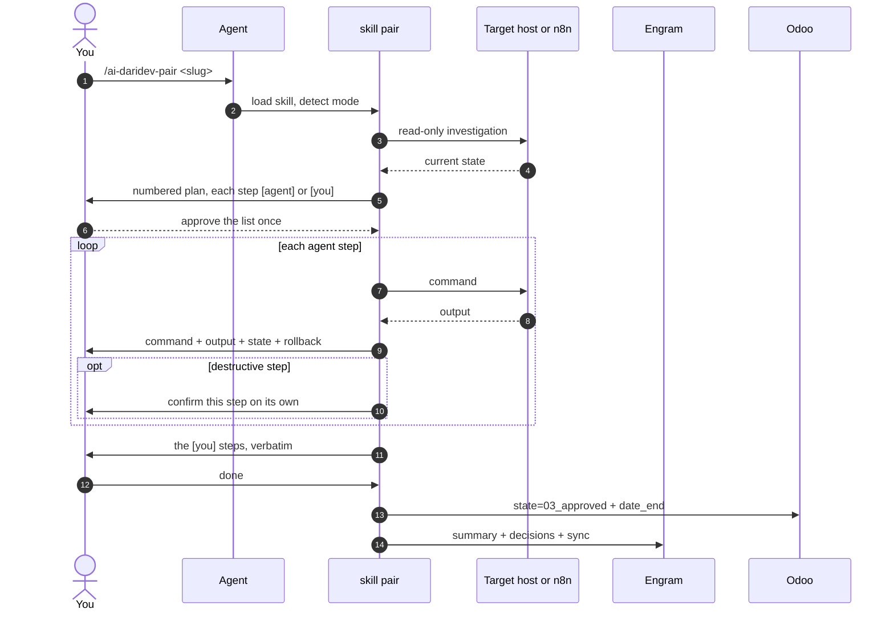

# Workflow

Two paths, same entry point. `/ai-daridev-pair` picks one from the repository, not from the story text.

## Roles

| Role | Does | Does not |
|---|---|---|
| **Owner** | `/ai-daridev-backlog`, `/ai-daridev-story`, `/ai-daridev-pair` for own work, `/ai-daridev-review` for someone else's card, moves columns | build every card alone |
| **Team member** | builds (with the agent), creates/flips markers, hands the change back | move columns, mark cards done, create cards |

The column is the owner's acceptance signal. That is the one rule nothing bypasses.
`/ai-daridev-pair` already closes your own work; `/ai-daridev-review` is for a card someone else
built — running it on your own pair output is optional and redundant.

## Markers

Every card may carry 2–4 **tracking markers**: component-sized names, mirrored as hidden Odoo
subtasks and echoed on the card's `Markers:` line.

- Name + state only. Never a description, a column, dates or a key.
- **Hidden from the board**: markers are created with `display_in_project=False`, the same flag the
  form exposes as "Hide the sub-task in your pipeline". `project_id` is computed from the parent
  (and mandatory), so the skills never write it.
- States: `01_in_progress` working · `1_done` validated · `02_changes_requested` rejected.
- Markers use `1_done`; the **card** never does (it would vanish from the kanban). `1_canceled` is
  human-only on both.
- Created by `/ai-daridev-backlog`, flipped by `/ai-daridev-pair`, adjusted by
  `/ai-daridev-review`.
- Because they are hidden inside the card, a teammate who copies the card text recreates them from
  the `Markers:` line. That line is rewritten whenever a marker is added or removed.

## Choosing the path

| Signal in the repo | Path |
|---|---|
| application code + a test runner | test-driven (§1) |
| only JSON / YAML / config, no test runner | non-code (§2) |
| both or neither | `/ai-daridev-pair` asks once |

## 1. Code project



1. `/ai-daridev-backlog` — stories in the first stage, one tag each, order preserved.
2. `/ai-daridev-story` — criteria + tests into the card, spec into memory.
3. `/ai-daridev-pair <slug>` — test list approved, then one red/green step at a time. It stops after every step.
4. Durable decisions are saved silently; small ones stay in the conversation.
5. Close — green dot + end date, ADR only when it affects other people.
6. `engram sync`, then **you** commit.
7. `/ai-daridev-archive <slug>` when done; `/ai-daridev-archive` alone for the sprint.

## 2. Non-code project

Same card, same memory, different execution.



1. The agent investigates **without changing anything**.
2. It proposes a numbered plan, marking each step `[agent]` or `[you]`.
3. You approve the list once.
4. It runs its steps one at a time and shows, after each: the command, the output, the resulting
   state (diff, service status, curl result) and a one-line rollback.
5. Destructive steps ask again on their own — being in the plan is not permission.
6. It hands you the steps only you can do, then closes the story like any other.

## 3. Reviewing someone else's work

`/ai-daridev-review <card>` (or bare: list "Sprint in Progress" and ask). It reads the card, asks
for evidence only when the card does not settle it, prints a verdict table, and proposes writes.

**Case i — correct**

```
Verdict: all criteria pass
Proposed: stage Sprint in Progress → Sprint Complete
```

One write, after a separate confirmation. States and markers are left alone.

**Case ii — wrong, no markers yet**

```
Proposed:
  create markers: "fix: header nav links", "fix: mobile spacing"
  parent + new markers → 02_changes_requested
  Review (ai-daridev) block with the detail
  no column move
```

**Case iii — partially wrong**

```
Verdict per marker: form organism pass · input field fail · button component fail
Proposed:
  parent → 02_changes_requested
  only the two failing markers → 02_changes_requested
  Review block listing only the failures
  no column move
```

Re-review only touches the yellow markers. Nothing green is re-litigated.

Without Odoo it prints the checklist (states, markers, Review block, "move it in Odoo or ask the
owner") and writes nothing.

## Closing checklist

- [ ] acceptance criteria verified, manual ones included
- [ ] markers reflect reality (green only where validated)
- [ ] review block written when the work was reviewed by someone else
- [ ] durable decisions saved
- [ ] ADR written if the decision is project-wide, hard to reverse, or affects a shared contract
- [ ] card: `state=03_approved`, `date_end` set, **stage untouched**
- [ ] `user_ids` untouched: cards stay unassigned unless you asked for an assignee
- [ ] session summary saved, `engram sync` run
- [ ] `.engram/` and `docs/decisions/` committed by a human
